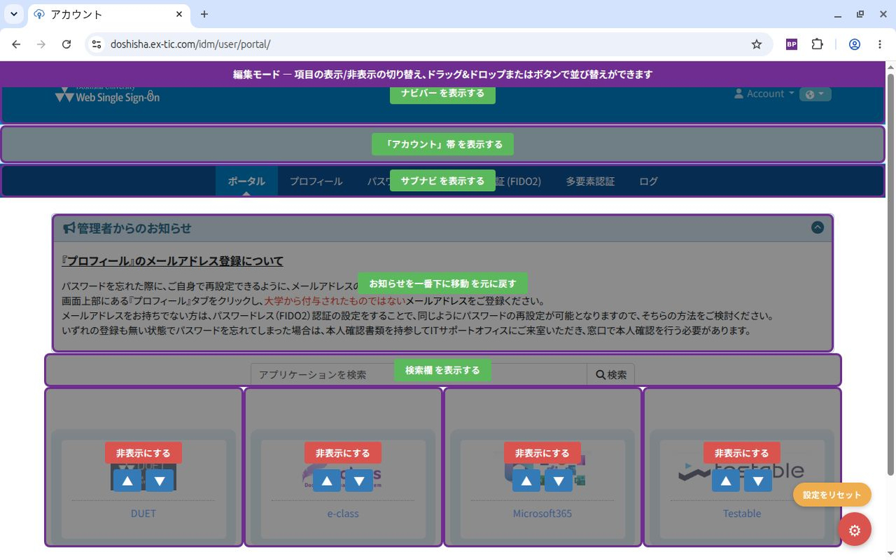
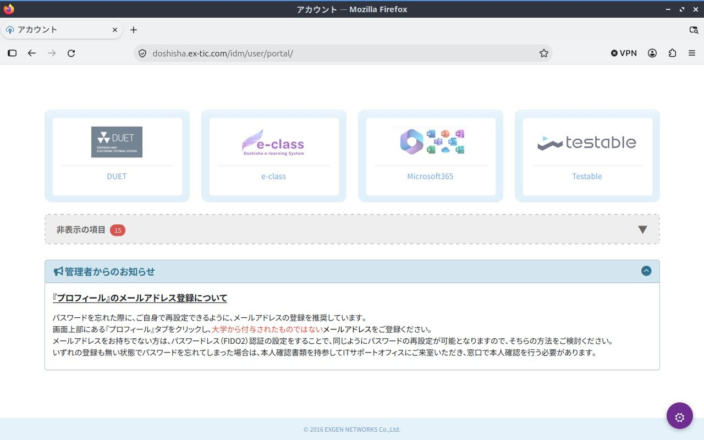
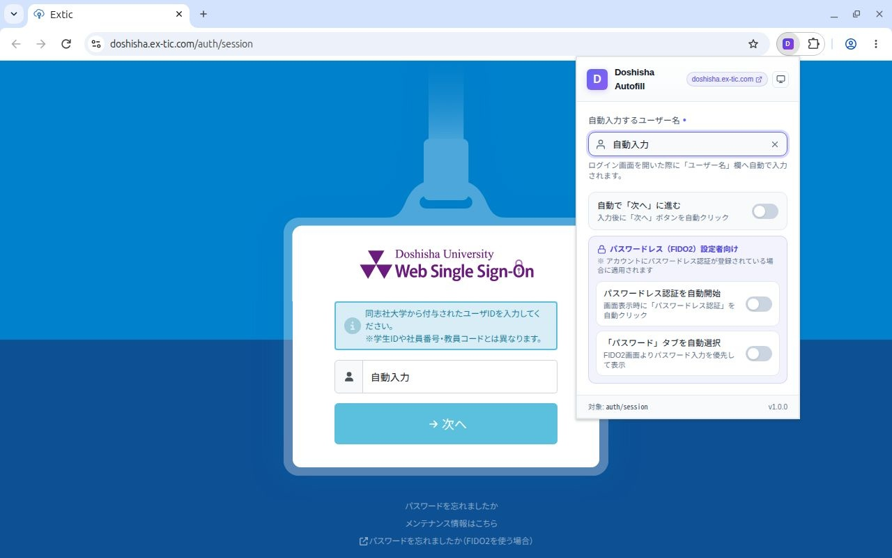
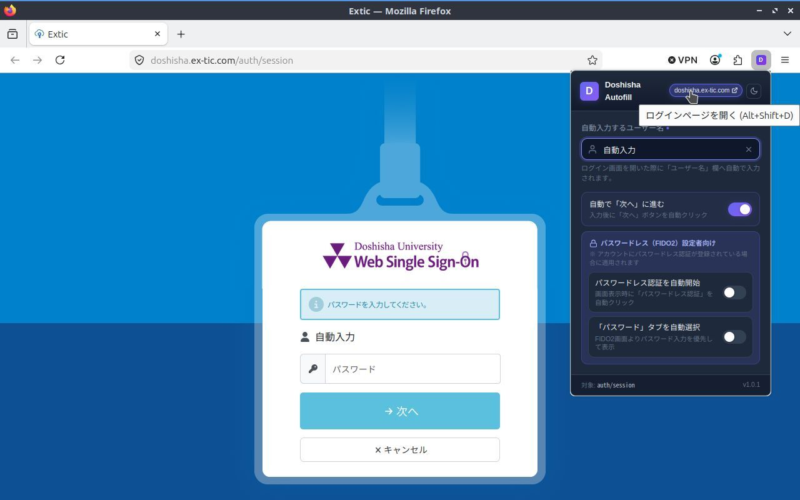

# Better Portal for Doshisha

同志社大学のポータル・アカウント管理画面（`https://doshisha.ex-tic.com/idm/user/*`）のレイアウトカスタマイズ（並び替え・非表示・独自カード追加等）と全画面ダークモード対応、および認証システム（`https://doshisha.ex-tic.com/auth/*`）におけるログイン・認証の自動化を一括で行うブラウザ拡張機能です。

| Chrome (Chromium系ブラウザ) | Firefox (Firefox系ブラウザ) |
| :---: | :---: |
|  |  |
|  |  |
| [👉 Chrome ウェブストアからインストール](https://chromewebstore.google.com/detail/nlppijonljmbghknljikakdeinkjacmi) | [👉 Firefox ADD-ONS からインストール](https://addons.mozilla.org/en-US/firefox/addon/better-portal-for-doshisha/) |

---

## 🌟 特徴

### 1. ポータル・アカウント管理画面カスタマイズ機能（`/idm/user/*`）
- **直感的なドラッグ＆ドロップ並び替え**: サービスカードを掴んで動かすだけで周囲のカードがリアルタイムに滑らかに並び替わり、点線の着地枠で配置先も一目で分かります（タッチ端末での長押しドラッグにも対応）。
- **ボタン操作（▲/▼）での並び替えにも対応**: ドラッグ操作がしづらい環境や微調整のために、各カードにワンクリック移動ボタンを完備。
- **不要な項目の非表示化**: 使わないサービスカードをワンクリックで非表示にして、画面をシンプルに整理。
- **非表示項目の折りたたみ管理（アコーディオン）**: 非表示にした項目はページ下部の折りたたみセクションに隔離。件数バッジ付きで、いつでもワンクリックでメイン画面に復帰可能。
- **各種UI要素の表示/非表示切替**:
  - ナビバー（上部バー）
  - サブナビ
  - 「アカウント」タイトル帯
  - 検索欄
- **「お知らせ」の位置移動**: 画面上部の大部分を占める「重要なお知らせ」をポータル最下部に移動させ、目的のサービスカードへ素早くアクセス可能。
- **「お知らせ」の既読折りたたみ・更新検知**: 「管理者からのお知らせ」を「✓ 確認済みにする」で既読化すると次回アクセス時から自動で折りたたまれ、新着や内容変更があったときだけ「未読」として自動で再展開。すでに確認済みの段落はカード内の「▸ 確認済みの内容を表示」に折りたたまれ、新しいお知らせだけをすぐ確認できます。
- **Microsoft 365 のリダイレクト先変更**: Microsoft 365 カードクリック時の遷移先を、動作確認済みの選択肢（OneDrive (SharePoint) / Outlook）または「その他」の任意URLからカスタマイズ可能。専用モーダルダイアログで直感的に設定・初期化できます。
- **オリジナルカードの作成・追加**: よく使うWebサイトへのカードを自由に作成可能。アイコンはデフォルト／絵文字／画像URLから選べ、リアルタイムプレビュー付き。クリック時は別タブで直接遷移し、並び替え・非表示・編集・削除にも対応。
- **ワンクリックリセット**: 設定を初期状態に戻したいときは「設定をリセット」ボタンでいつでも復元可能（ユーザーが作成したオリジナルカードは保持されます）。

### 2. ログイン・認証自動化機能（`/auth/*`）
- **完全自動入力**: ログインページを開くだけで、登録されたユーザー名を即座に自動入力。
- **「次へ」ボタン自動クリック（ON/OFF切替可能）**: ユーザー名入力後、自動で「次へ」ボタンを押してパスワード画面へ進むオプションを搭載。
- **パスワードレス認証の自動開始（ON/OFF切替可能）**: 「次へ」押下後にパスワードレス（FIDO2）認証画面が表示された場合、自動で「パスワードレス認証」ボタンをクリックしてパスキー認証（Windows Hello等）を自動起動。
- **「パスワード」タブの自動選択（ON/OFF切替可能）**: FIDO2が利用可能な環境でも、パスワード入力を優先したい場合に「パスワード」タブを自動で選択して表示。
- **パスワード入力欄への自動フォーカス（標準搭載）**: パスワード画面表示時に自動で入力欄（`#password`）にフォーカスを当て、キーボードから手を離さずに即座に入力開始可能。
- **ポータルへすぐ移動（`Alt+Shift+D`）**: DUET・e-class・Microsoft 365 などでタブがたくさん開いていても、ショートカットキーひとつで同志社ポータル画面へすぐに移動できます（開いていない場合は新しいタブで開きます／Mac: `Option+Shift+D`）。

### 3. 全画面ダークモード・外観テーマ対応（`/auth/*`・`/idm/user/*`・`/imgmtx/*`）
- **完全ダークモード対応**: ログイン画面（`/auth/*`）、ポータル・アカウント管理画面（`/idm/user/*`）、マトリクス認証画面（`/imgmtx/*`）、および拡張機能ポップアップの全画面に対応。
- **外観テーマ切替（システム連動／ライト／ダーク）**: OSのカラーテーマ設定に自動連動する「システム設定」のほか、「ライト」「ダーク」をポップアップからいつでも自由に切り替え可能。

### 4. 共通仕様
- **Manifest V3 準拠**: 最新の Chrome / Firefox / Edge / Brave 等のブラウザ仕様に対応。
- **安全な同期/ローカルストレージ**: すべての設定値とユーザー名はブラウザ内の `browser.storage.sync`（または `local`）にのみ安全に保存され、外部サーバーへ送信されることは一切ありません。

---

## 📦 インストール方法

### 1. 公式ストアからインストール（推奨）

- **Google Chrome / Microsoft Edge / Brave 等（Chromium系ブラウザ）**  
  👉 **[Chrome ウェブストアからインストール](https://chromewebstore.google.com/detail/nlppijonljmbghknljikakdeinkjacmi)**  
  *※ Edge や Brave などの Chromium 系ブラウザでも、上記リンクからそのまま追加してご利用いただけます。*

- **Mozilla Firefox / Zen / Floorp 等（Firefox系ブラウザ）**  
  👉 **[Firefox ADD-ONS からインストール](https://addons.mozilla.org/en-US/firefox/addon/better-portal-for-doshisha/)**  
  *※ Zen や Floorp などの Firefox 系ブラウザでも、上記リンクからそのまま追加してご利用いただけます。*

---

### 2. ソースコードから読み込む場合（開発・カスタマイズ時）

機能開発やカスタマイズを行う場合は、以下のデベロッパーモードを用いた読み込み手順をご利用ください。

#### Google Chrome / Microsoft Edge / Brave 等（Chromium系ブラウザ）
1. 本リポジトリをクローンするか、ZIPファイルをダウンロードして展開します。
2. ブラウザで拡張機能管理画面を開きます。
   - Chrome: `chrome://extensions/`
   - Edge: `edge://extensions/`
3. 画面右上にある「**デベロッパー モード**」を有効にします。
4. 左上に表示される「**パッケージ化されていない拡張機能を読み込む**」ボタンをクリックします。
5. リポジトリ内の **`src` ディレクトリ**（※リポジトリのルートではなく、必ず `src` フォルダ）を選択して読み込みます。

#### Mozilla Firefox / Zen / Floorp 等（Firefox系ブラウザ）
1. アドレスバーに `about:debugging#/runtime/this-firefox` と入力して開きます。
2. 「**一時的なアドオンを読み込む...**」ボタンをクリックします。
3. リポジトリ内の **`src/manifest.json`** ファイルを選択します。  
   *※ 一時的なアドオンとして読み込まれるため、ブラウザ再起動時には再読み込みが必要になります。*

---

## 💡 使い方

### ログイン自動化の設定（ポップアップ画面）
1. ツールバーの拡張機能アイコン（紫色の「D」アイコン）をクリックしてポップアップを開きます。
2. **「自動入力するユーザー名」** 欄に、ログインで使用するユーザー名を入力します。
3. お好みに応じて各種オプションのスイッチを設定します：
   - **「自動で「次へ」に進む」**: ユーザー名入力後、自動的に「次へ」ボタンを押します。
   - **「パスワードレス（FIDO2）設定者向け」グループ**（FIDO2認証が登録されているアカウント用）:
     - **「パスワードレス認証を自動開始」**: パスワードレス画面が表示された場合、自動的に「パスワードレス認証」ボタンを押してWindows Helloやセキュリティキーを起動します。
     - **「「パスワード」タブを自動選択」**: パスワードレス画面ではなく、パスワード入力タブを優先して自動選択します（FIDO2自動開始と排他で安全に制御）。
   ※ パスワード画面が表示された際は、設定不要で常に自動的にパスワード入力欄へフォーカスが当たります。
4. 入力内容や各種オプションはすべて**自動保存**されます。
5. **ショートカットキー `Alt+Shift+D`**（Mac: `Option+Shift+D`）を押すか、ポップアップ右上のバッジをクリックすれば、どこからでも同志社ポータル（`https://doshisha.ex-tic.com/idm/user/portal/`）へ移動できます（すでに開いているポータルタブがあればそちらに切り替わり、開いていない場合は新しいタブで開きます）。

### ポータル画面のレイアウト編集（ポータル画面上）
1. 同志社大学ポータル（`https://doshisha.ex-tic.com/idm/user/portal/`）にアクセスします。
2. 画面右下に表示される紫色の**歯車ボタン（⚙）**をクリックすると、「**編集モード**」が起動します（画面上部に紫色の帯が表示されます）。
3. 編集モード中に以下の操作が可能です：
   - **並び替え**: カードをドラッグ＆ドロップ（タッチ端末では長押し後にドラッグ、ドラッグ中は `Esc` キーでキャンセル可能）するか、カード中央の「▲」「▼」ボタンをクリックして順序を入れ替えます。
   - **カードの非表示**: カード上の赤色の「非表示にする」ボタンをクリックします。
   - **非表示カードの復帰**: 画面下部に表示される「非表示の項目」アコーディオンを開き、緑色の「表示する」ボタンをクリックします。
   - **Microsoft 365 のリンク先変更**: Microsoft 365 カード上の「リンク先を変更」ボタンをクリックし、表示されるモーダルダイアログでリンク先（デフォルト／OneDrive (SharePoint)／Outlook／その他）を選択して「保存」をクリックします。「Outlook」では新方式／旧方式から選択でき、「その他」を選択した場合は任意のURLと遷移方式（新方式／旧方式）を指定できます。
   - **オリジナルカードの追加**: カード一覧の末尾に表示される破線枠の「**＋ 新規カードを追加**」をクリックし、タイトル・URL・アイコン（デフォルト／絵文字／画像URL）を入力して「追加」を押します。プレビューで見た目を確認しながら作成できます。
   - **オリジナルカードの編集・削除**: 作成したカード上の「編集」「削除」ボタンから変更・削除できます。並び替えや非表示も通常のカードと同様に行えます。
   - **ナビバー・検索欄等の非表示**: ナビバー、サブナビ、「アカウント」帯、検索欄の上に重なって表示されるボタンをクリックして表示/非表示を切り替えます。
   - **お知らせの移動**: お知らせエリア上の「お知らせを一番下に移動」ボタンをクリックします。
4. 変更した設定は**すべて自動保存**されます。
5. もう一度右下の歯車ボタン（⚙）をクリックすると編集モードが終了し、カスタマイズ後のすっきりとしたポータル画面を利用できます。
6. 設定を初期状態に戻したい場合は、編集モード中に歯車ボタンの上に現れるオレンジ色の「**設定をリセット**」ボタンをクリックします（作成したオリジナルカードは削除されません）。

### お知らせの既読・折りたたみ管理（ポータル画面上）
1. 「管理者からのお知らせ」下部の「**✓ 確認済みにする**」をクリックすると、お知らせが即座に折りたたまれ、以降のアクセスでも閉じた状態が維持されます（ヘッダーに「確認済み」バッジ表示）。
2. 新しいお知らせの追加や文面・リンク変更があった場合は「未読」として自動で再展開されます。このとき、すでに確認済みの段落は薄字表示になり、カード内の「**▸ 確認済みの内容を表示**」バーに折りたたまれます（クリックでその場での開閉が可能）。
3. 確認済みの状態でも、お知らせのヘッダーをクリックすればいつでも中身を確認でき、下部の「**未読に戻す**」から未読状態へ戻せます。

---

## 📂 ファイル構成

```
.
├── .github/
│   └── workflows/
│       └── release.yml            # GitHub Releases 自動パッケージ・リリース
├── publish/                       # ストア公開用資料・画像アセット
│   ├── Chrome Web Store.md        # Chrome Web Store 掲載情報・審査申請内容
│   ├── Firefox Browser ADD-ONS.md # Firefox Browser ADD-ONS 掲載情報
│   └── assets/                    # ストア掲載用スクリーンショット
│       ├── Chrome/
│       └── Firefox/
├── src/                           # 拡張機能ソースコード（読み込み対象）
│   ├── manifest.json              # 拡張機能の設定・権限定義 (Manifest V3)
│   ├── background.js              # バックグラウンドスクリプト（ショートカット起動等）
│   ├── auth/                      # ログイン・認証自動化 (/auth/*)
│   │   └── content.js             # ログイン・認証画面自動入力スクリプト
│   ├── theme/                     # 外観テーマ（ダークモード）制御
│   │   ├── content.js             # テーマ連動・即時反映スクリプト
│   │   └── content.css            # 各ページ共通・専用ダークモードスタイル
│   ├── popup/                     # ポップアップ設定画面
│   │   ├── index.html             # ポップアップ設定画面UI
│   │   ├── index.css              # ポップアップ設定画面スタイル
│   │   └── index.js               # ポップアップ設定画面ロジック・ストレージ保存連携
│   ├── welcome/                   # 初回インストール時ウェルカムページ
│   │   ├── index.html             # 初心者向け初期設定・使い方・FAQ UI
│   │   ├── index.css              # ウェルカムページスタイル（ライト/ダーク対応）
│   │   └── index.js               # 初期設定保存・テーマ管理・ポップアップ連携
│   ├── portal/                    # ポータル画面カスタマイズ (/idm/user/*)
│   │   ├── constants.js           # 定数・セレクタ・トグル設定
│   │   ├── dom-utils.js           # DOM生成・FLIPアニメーション・モーダル基盤
│   │   ├── order-logic.js         # カード並び順計算（純粋ロジック）
│   │   ├── url-m365.js            # URL検証・Microsoft 365 リダイレクト書換
│   │   ├── storage.js             # ストレージ永続化・先読み・描画ヒントキャッシュ
│   │   ├── notice-logic.js        # お知らせ差分検知・折りたたみグループ算出
│   │   ├── m365-modal.js          # Microsoft 365 リンク先設定モーダル
│   │   ├── custom-cards.js        # オリジナルカード生成・編集モーダル
│   │   ├── toggles.js             # ナビバー・検索欄等の表示切替制御
│   │   ├── notice-controller.js   # お知らせDOM状態・既読折りたたみ制御
│   │   ├── drag-drop.js           # Pointer Events + FLIP 並び替え制御
│   │   ├── content.js             # ポータル画面オーケストレータ
│   │   ├── content.css            # ポータルカスタマイズ・編集UI用スタイル
│   │   └── page.js                # ポータル画面 MAIN world スクリプト（M365リンク書換）
│   └── icons/                     # 拡張機能アイコン画像
│       ├── icon16.png
│       ├── icon48.png
│       └── icon128.png
├── tests/                         # 自動テスト（Node.js 標準テストランナー）
│   ├── helpers/
│   │   └── test-helpers.mjs       # DOM・ストレージモックおよびテスト基盤
│   ├── manifest-and-syntax.test.mjs # manifest.json・全JSファイル構文検証
│   ├── portal-integration.test.mjs  # ポータル画面統合テスト
│   └── portal-logic.test.mjs        # 純粋ロジック単体テスト
├── DEVELOPMENT_NOTES.md           # 開発・設計技術メモ
├── LICENSE                        # MIT License
├── PRIVACY_POLICY.md              # プライバシーポリシー
└── README.md                      # 本説明書
```

---

## 🧪 テスト

外部パッケージは不要で、Node.js 標準のテストランナーを使用してすべての単体・統合テストを実行できます。

```bash
node --test tests/*.test.mjs
```

---

## 🔒 プライバシーポリシー

本拡張機能は、ユーザーのプライバシーを尊重し、個人情報や認証情報（パスワード等）を外部サーバーへ収集・送信することは一切ありません。すべての設定データとユーザー名はブラウザ内の同期/ローカルストレージにのみ安全に保存されます。

詳細は [PRIVACY_POLICY.md](PRIVACY_POLICY.md) をご確認ください。

---

## ⚠️ 注意事項

- **免責事項・非公式について**:  
  本拡張機能は個人によって開発された**非公式ツール**であり、同志社大学および関連組織・サービス提供元とは一切関係ありません。本拡張機能の利用により生じたいかなる損害についても開発者は責任を負いかねます。
- **大学側のポータル・認証画面の仕様変更について**:  
  同志社大学ポータル画面および認証画面のHTML構造（要素のID名やクラス名）が大幅に変更された場合、一時的に機能しなくなる可能性があります。

---

## 📄 ライセンス

本ソフトウェアは [MIT License](LICENSE) のもとで公開されています。  
Copyright (c) 2026 tadashin
