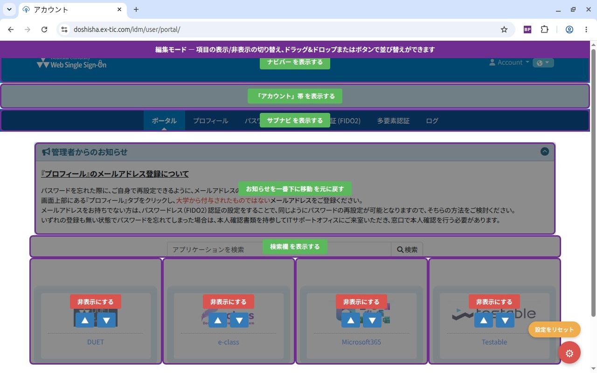
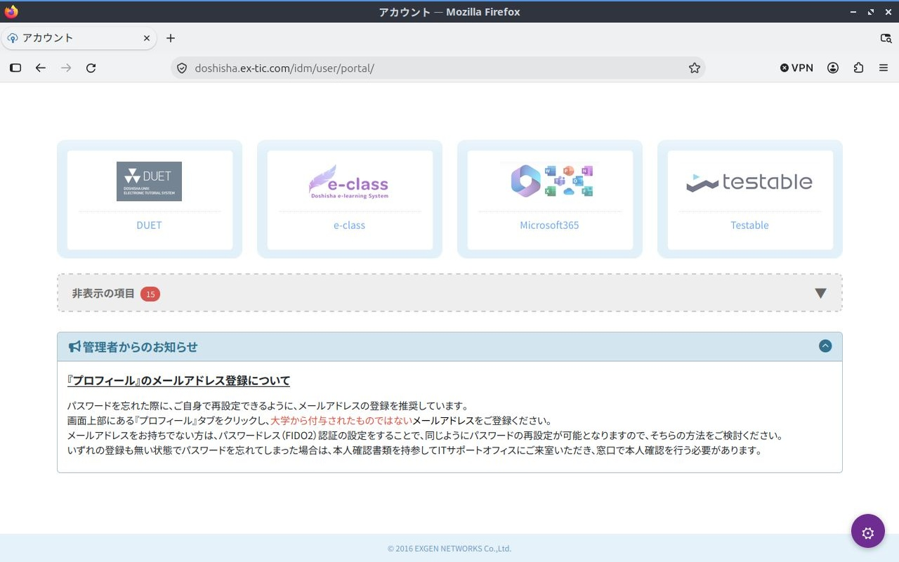

# Better Portal for Doshisha

同志社大学のポータル画面（`https://doshisha.ex-tic.com/idm/user/portal/*`）において、各サービスカードの並び替え・非表示や、各種UI要素（ナビバー、サブナビ、ページタイトル、検索欄、お知らせ等）の表示切り替えを自由に行えるブラウザ拡張機能です。

| Chrome (Chromium系ブラウザ) | Firefox (Firefox系ブラウザ) |
| :---: | :---: |
|  |  |
| 👉 Chrome ウェブストアからインストール（公開準備中） | 👉 Firefox ADD-ONS からインストール（公開準備中） |

---

## 🌟 特徴

- **Manifest V3 準拠**: 最新の Chrome / Firefox / Edge / Brave 等のブラウザ仕様に対応。
- **直感的なドラッグ＆ドロップ並び替え**: サービスカードをマウスで掴んで好みの位置へ自由に並び替え可能。青紫色のインジケーターで挿入位置も一目で分かります。
- **ボタン操作（▲/▼）での並び替えにも対応**: ドラッグ操作がしづらい環境や微調整のために、各カードにワンクリック移動ボタンを完備。
- **不要な項目の非表示化**: 使わないサービスカードをワンクリックで非表示にして、画面をシンプルに整理。
- **非表示項目の折りたたみ管理（アコーディオン）**: 非表示にした項目はページ下部の折りたたみセクションに隔離。件数バッジ付きで、いつでもワンクリックでメイン画面に復帰可能。
- **各種UI要素の表示/非表示切替**:
  - ナビバー（上部バー）
  - サブナビ
  - 「アカウント」タイトル帯
  - 検索欄
- **「お知らせ」の位置移動**: 画面上部の大部分を占める「重要なお知らせ」をポータル最下部に移動させ、目的のサービスカードへ素早くアクセス可能。
- **Microsoft365のリダイレクト先URL変更**: Microsoft365カードクリック時の遷移先URL（OneDriveやSharePointなど）を任意のURLにカスタマイズ可能。
- **チラツキ防止（FOUC対策）**: ページ読み込み時にオリジナルのレイアウトが一瞬表示されるのを防止し、整ったレイアウトで滑らかにフェードイン表示。
- **ワンクリックリセット**: 設定を初期状態に戻したいときは「設定をリセット」ボタンでいつでも復元可能。
- **安全なローカルストレージ**: すべての設定値はブラウザ内のローカルストレージ（`browser.storage.local` 等）にのみ安全に保存され、外部サーバーへ送信されることは一切ありません。

---

## 📦 インストール方法

### 1. 公式ストアからインストール（準備中）

各ストアでの公開が完了次第、リンクよりワンクリックでインストールいただけます。

---

### 2. ソースコードから読み込む場合（開発・カスタマイズ時）

機能開発やカスタマイズを行う場合は、以下のデベロッパーモードを用いた読み込み手順をご利用ください。

#### Google Chrome / Microsoft Edge / Brave 等（Chromium系ブラウザ）
1. 本リポジトリをクローンするか、ZIPファイルをダウンロードして展開します。
2. ブラウザで拡張機能管理画面を開きます。
   - Chrome: `chrome://extensions/`
   - Edge: `edge://extensions/`
3. 画面右上にある「**デベロッパー モード**」を有効にします。
4. 左上に表示される「**パッケージ化されていない拡張機能を読み込む**」ボタンをクリックします。
5. リポジトリ内の **`src` ディレクトリ**（※リポジトリのルートではなく、必ず `src` フォルダ）を選択して読み込みます。

#### Mozilla Firefox / Zen / Floorp 等（Firefox系ブラウザ）
1. アドレスバーに `about:debugging#/runtime/this-firefox` と入力して開きます。
2. 「**一時的なアドオンを読み込む...**」ボタンをクリックします。
3. リポジトリ内の **`src/manifest.json`** ファイルを選択します。  
   *※ 一時的なアドオンとして読み込まれるため、ブラウザ再起動時には再読み込みが必要になります。*

---

## 💡 使い方

1. 同志社大学ポータル（`https://doshisha.ex-tic.com/idm/user/portal/`）にアクセスします。
2. 画面右下に表示される紫色の**歯車ボタン（⚙）**をクリックすると、「**編集モード**」が起動します（画面上部に紫色の帯が表示されます）。
3. 編集モード中に以下の操作が可能です：
   - **並び替え**: カードをドラッグ＆ドロップするか、カード中央の「▲」「▼」ボタンをクリックして順序を入れ替えます。
   - **カードの非表示**: カード上の赤色の「非表示にする」ボタンをクリックします。
   - **非表示カードの復帰**: 画面下部に表示される「非表示の項目」アコーディオンを開き、緑色の「表示する」ボタンをクリックします。
   - **Microsoft365のリンク先変更**: Microsoft365カード上の「リンク先を変更」ボタンをクリックし、遷移したいURL（例: `https://doshishaacjp-my.sharepoint.com/my`）を入力します（空欄にするとデフォルトに戻ります）。
   - **ナビバー・検索欄等の非表示**: ナビバー、サブナビ、「アカウント」帯、検索欄の上に重なって表示されるボタンをクリックして表示/非表示を切り替えます。
   - **お知らせの移動**: お知らせエリア上の「お知らせを一番下に移動」ボタンをクリックします。
4. 変更した設定は**すべて自動保存**されます。
5. もう一度右下の歯車ボタン（⚙）をクリックすると編集モードが終了し、カスタマイズ後のすっきりとしたポータル画面を利用できます。
6. 設定を初期状態に戻したい場合は、編集モード中に歯車ボタンの上に現れるオレンジ色の「**設定をリセット**」ボタンをクリックします。

---

## 📂 ファイル構成

```
.
├── .github/
│   └── workflows/
│       └── release.yml            # GitHub Releases 自動パッケージ・リリース
├── publish/                       # ストア公開用資料・画像アセット
│   ├── Chrome Web Store.md        # Chrome Web Store 掲載情報・審査申請内容
│   ├── Firefox Browser ADD-ONS.md # Firefox Browser ADD-ONS 掲載情報
│   └── assets/                    # ストア掲載用スクリーンショット
│       ├── Chrome/
│       └── Firefox/
├── src/                           # 拡張機能ソースコード（読み込み対象）
│   ├── manifest.json              # 拡張機能の設定・権限定義 (Manifest V3)
│   ├── content.js                 # ポータルカスタマイズ処理スクリプト
│   ├── content.css                # カスタマイズ・編集UI用スタイル
│   └── icons/                     # 拡張機能アイコン画像
│       ├── icon16.png
│       ├── icon48.png
│       └── icon128.png
├── DEVELOPMENT_NOTES.md           # 開発・設計技術メモ
├── LICENSE                        # MIT License
├── PRIVACY_POLICY.md              # プライバシーポリシー
└── README.md                      # 本説明書
```

---

## 🔒 プライバシーポリシー

本拡張機能は、ユーザーのプライバシーを尊重し、個人情報や認証情報を外部サーバーへ収集・送信することは一切ありません。すべてのレイアウト設定はブラウザ内のローカルストレージにのみ安全に保存されます。

詳細は [PRIVACY_POLICY.md](PRIVACY_POLICY.md) をご確認ください。

---

## ⚠️ 仕様・注意事項

- **免責事項・非公式について**:  
  本拡張機能は個人によって開発された**非公式ツール**であり、同志社大学および関連組織・サービス提供元とは一切関係ありません。本拡張機能の利用により生じたいかなる損害についても開発者は責任を負いかねます。
- **大学側のポータル画面の仕様変更について**:  
  同志社大学ポータル画面のHTML構造（要素のID名やクラス名）が大幅に変更された場合、一時的に機能しなくなる可能性があります。

---

## 📄 ライセンス

本ソフトウェアは [MIT License](LICENSE) のもとで公開されています。  
Copyright (c) 2026 tadashin
